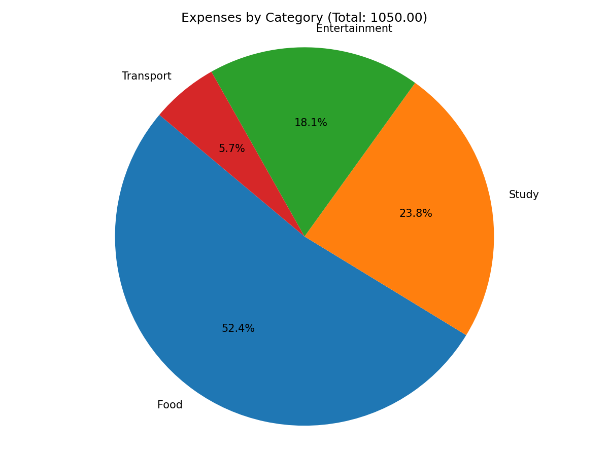

# Expense Tracker

A simple Python CLI expense-tracking tool with a category-based pie chart visualization.

## Setup

Install `matplotlib`:

```bash
py -m pip install matplotlib
```

## How to Run

### 1. Input Module (Member A)
Run the input module to enter expenses (`date`, `amount`, `category`, and optional `notes`) and store the data in `expenses.csv`:

```bash
py input_expense.py
```

### 2. Visualization Module (Member B)
Run the visualization module to load `expenses.csv`, group expenses by `category`, and generate a pie chart (`sample_piechart.png`):

```bash
py visualize.py
```

## Sample Pie Chart

